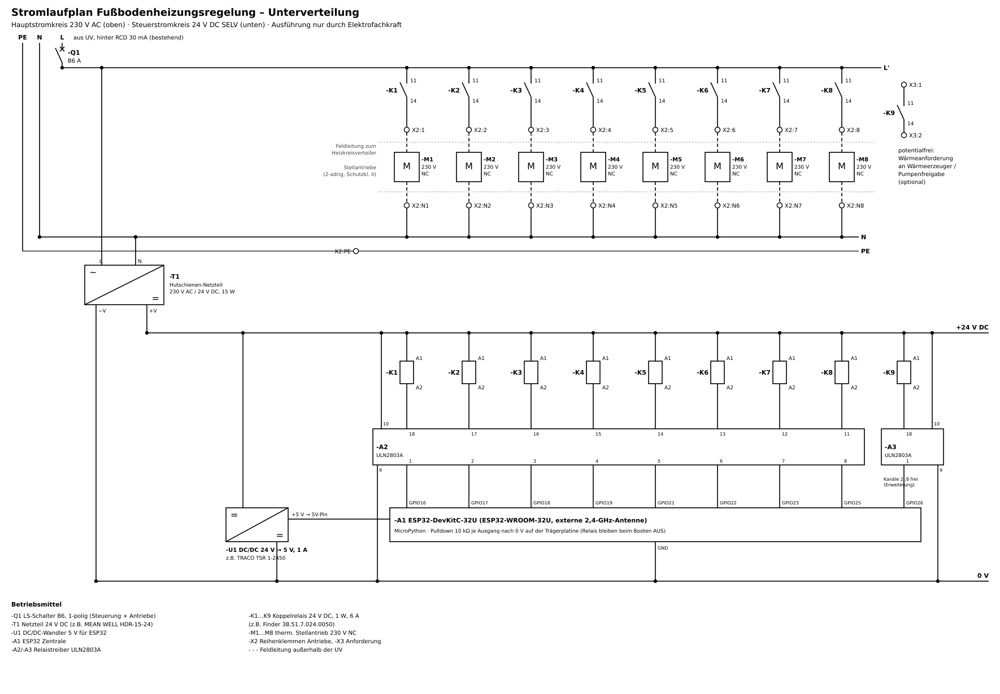

# Fußbodenheizungsregelung mit ESP32 (Funk‑Raumsensoren + 230‑V‑Stellantriebe)

Einzelraumregelung für eine wassergeführte Fußbodenheizung:

* **Raumsensoren** (ESP32‑C3 + Sensirion SHT40) messen Temperatur/Feuchte und funken per **ESP‑NOW** an die Zentrale – ein WLAN‑Router ist dafür **nicht** nötig.
* **Zentrale** (ESP32 mit externer Antenne) sitzt in der **Unterverteilung (UV)**, regelt jede Zone (PI‑Regler + langsame PWM) und schaltet über **Koppelrelais** die zugekauften **thermischen 230‑V‑Stellantriebe** am Heizkreisverteiler.
* Programmiersprache: **MicroPython** (Python auf dem Mikrocontroller). Der Regelkern läuft identisch auf dem PC (Simulation + Tests).

> ⚠️ **Sicherheit / Recht:** Arbeiten an der elektrischen Anlage hinter der Hausanschlusssicherung dürfen – außer durch den Netzbetreiber – nur von einem **in ein Installateurverzeichnis eingetragenen Elektroinstallationsunternehmen** ausgeführt werden (§ 13 NAV) [Q1]. Der 230‑V‑Teil (UV, Q1, Relaiskontakte, Feldleitung, Stellantriebe) ist daher von einer Elektrofachkraft zu errichten und zu prüfen. Der Eigenbau beschränkt sich sinnvoll auf die Kleinspannungs‑Elektronik (Trägerplatine, Raumsensoren) und die Software.

---

## 1. Inhalt des Ordners

| Datei | Inhalt |
|---|---|
| `stueckliste.csv` | Stückliste (Semikolon‑getrennt, in Excel/LibreOffice öffnen) |
| `docs/systemuebersicht.svg` | Blockschaltbild Gesamtsystem |
| `docs/stromlaufplan.svg` | Stromlaufplan UV (230 V + 24 V), Zentrale ESP32 |
| `docs/stromlaufplan_esp32s3.svg` | dto. mit ESP32‑S3‑Board als Zentrale |
| `docs/hutschiene.svg` | Belegung der Hutschienen (Teilungseinheiten) |
| `firmware/zentrale/` | `main.py`, `config.py`, `regler.py` für den ESP32 in der UV |
| `firmware/raumsensor/` | `main.py`, `config.py`, `sht40.py` für jeden Raumsensor |
| `tools/simulation.py` | PC‑Simulation Raum + Regler (`--plot` erzeugt `tools/simulation.png`) |
| `tools/zeichne_plaene.py` | Erzeugt die SVG‑Pläne neu (z.B. für andere Kanalzahl) |
| `tests/test_regler.py` | Unit‑Tests des Regelkerns (`python3 -m unittest discover -s tests`) |

## 2. Systemübersicht


Beispielausbau: **6 Räume (Zonen), 8 Heizkreise**, 8 Relaiskanäle + 1 Kanal Wärmeanforderung. Ein Raum mit mehreren Heizkreisen bekommt **ein** Relais; dessen Stellantriebe werden parallel angeschlossen (siehe Klemmenplan). Freie Kanäle (K7, K8 im Beispiel) sind Reserve.

### Funktionsprinzip der Regelung

1. Jeder Raumsensor sendet jede Minute `{"t": 21.34, "h": 45.2}` an die MAC‑Adresse der Zentrale.
2. Die Zentrale akzeptiert nur Sensoren, deren MAC in `config.SENSOREN` eingetragen ist.
3. Je Zone berechnet ein **PI‑Regler** alle 20 min einen Stellgrad 0…100 %. Thermische Antriebe sind nur AUF/ZU und brauchen ca. 3 min Laufzeit [Q2]; deshalb wird der Stellgrad als **PWM mit 20 min Periode** ausgegeben (z.B. 40 % → 8 min bestromt, 12 min stromlos). Pulse < 10 % entfallen, > 90 % werden zu 100 %.
4. Die PWM‑Perioden der Zonen sind **zeitlich versetzt**, damit nicht alle Antriebe gleichzeitig einschalten.
5. Schutzfunktionen:
   * **Fühlerausfall** (15 min kein Messwert) → fester Ersatz‑Stellgrad 30 %
   * **Frostschutz** (< 8 °C) → Ventil voll auf
   * **Ventilschutz**: Ventil war 7 Tage nicht offen → 10 min öffnen (gegen Festsitzen)
   * **Watchdog**: hängt die Software, startet der ESP32 nach 60 s neu; beim Start sind alle Relais AUS.
6. **Nachtabsenkung** je Zone (optional) – nur wenn die Zentrale über WLAN die Uhrzeit (NTP) bekommt. Ohne WLAN regelt sie auf den festen Sollwert.
7. **K9 Wärmeanforderung** (potentialfreier Kontakt): geschlossen, solange mindestens eine Zone Wärme anfordert – z.B. zur Pumpen‑/Kesselfreigabe, falls der Wärmeerzeuger einen solchen Eingang hat (Herstelleranleitung!).

> Bei **stromlos geschlossenen (NC)** Antrieben gilt: Fällt die Zentrale aus, schließen alle Ventile. Das ist sicher gegen Überhitzung, die Räume kühlen aber langsam ab. Für Notbetrieb kann der Elektriker die Antriebe vorübergehend direkt an L' klemmen.

## 3. Stückliste

Vollständig in **[`stueckliste.csv`](stueckliste.csv)**. Kurzfassung (Beispiel 6 Räume / 8 Heizkreise):

| Baugruppe | Wesentliche Teile |
|---|---|
| Stellantriebe (Zukauf) | 8 × therm. Stellantrieb 230 V NC (z.B. Möhlenhoff/Theben Alpha 5) + passende Ventiladapter |
| Zentrale (UV) | ESP32‑DevKitC‑32U + Antenne, 2 × ULN2803A, DC/DC TSR 1‑2450, 9 × 10 kΩ, Platine, Hutschienengehäuse 6 TE |
| Zusatzkomponenten UV | LS B6 (Q1), Netzteil MEAN WELL HDR‑15‑24 (T1), 9 × Koppelrelais Finder 38.51 24 V DC (K1–K9), WAGO‑Reihenklemmen (X2/X3) |
| Feldverdrahtung | Steuerleitung UV → Heizkreisverteiler (z.B. 2 × NYM‑J 7×1,5), Abzweigkasten IP54, Verbindungsklemmen |
| Raumsensoren (je Raum) | ESP32‑C3‑DevKitM‑1, SHT40‑Breakout, Gehäuse, 5‑V‑USB‑Netzteil |

Die genannten Typen sind **Beispiele**; Bestellnummern bitte vor dem Kauf beim Händler/Hersteller prüfen. Preise habe ich bewusst nicht angegeben (nicht verifiziert).

## 4. Bauplan

### 4.1 Stromlaufplan Unterverteilung



Schaltzeichen nach DIN EN 60617, Kennbuchstaben nach DIN EN 81346‑2. Oben der 230‑V‑Hauptstromkreis (L' über Q1 → Schließer 11‑14 von K1…K8 → X2 → Stellantrieb → N), unten der 24‑V‑Steuerstromkreis (T1 → Relaisspulen A1; A2 über ULN2803A‑Ausgänge nach 0 V; ULN2803A Pin 10 „COM“ an +24 V für die internen Freilaufdioden, Pin 9 an 0 V).

### 4.2 Hutschienenbelegung


Platzbedarf ca. 18 TE. Ist die vorhandene UV voll, einen 2‑reihigen Aufputz‑Kleinverteiler daneben setzen. **Kunststoff‑UV bevorzugen**; bei Metall die Antenne (U.FL→SMA) nach außen führen.

### 4.3 Klemmenplan

| Klemme | Ader / Ziel | Quelle in der UV |
|---|---|---|
| X2:1 … X2:8 | L zu Stellantrieb(en) Zone 1…8 (braun/schwarz/grau/nummeriert) | K1…K8 Kontakt 14 |
| X2:N1 … X2:N8 | N der jeweiligen Zone (blau) | N‑Schiene hinter Q1 |
| X2:PE | Schutzleiter der Feldleitung (grün‑gelb) | PE‑Schiene |
| X3:1 / X3:2 | potentialfreier Kontakt Wärmeanforderung | K9 Kontakt 11 / 14 |
| K1…K9 A1 | +24 V (Brückenkamm) | T1 +V |
| K1…K8 A2 | ULN2803A (A2) Pin 18 … 11 | Trägerplatine |
| K9 A2 | ULN2803A (A3) Pin 18 | Trägerplatine |
| Q1 Eingang | L aus UV hinter RCD 30 mA | bestehende Anlage |
| T1 L/N | L' (hinter Q1) / N | — |

Feldleitung (Vorschlag, Auslegung durch Elektrofachkraft): **2 × NYM‑J 7×1,5 mm²**, Leitung 1 = Kanäle 1–5 + N + PE, Leitung 2 = Kanäle 6–8 (+2 Reserve) + N + PE. Am Heizkreisverteiler in einem Abzweigkasten IP54 auf die 1‑m‑Anschlussleitungen der Stellantriebe klemmen; mehrere Antriebe einer Zone parallel an dieselbe Ader.

### 4.4 Trägerplatine Zentrale (Kleinspannung, Eigenbau)

| ESP32‑DevKitC‑32U | → | ULN2803A | → | Relais |
|---|---|---|---|---|
| GPIO16 | 10 kΩ nach GND | A2 Pin 1 → Pin 18 | → | K1 A2 |
| GPIO17 | 10 kΩ nach GND | A2 Pin 2 → Pin 17 | → | K2 A2 |
| GPIO18 | 10 kΩ nach GND | A2 Pin 3 → Pin 16 | → | K3 A2 |
| GPIO19 | 10 kΩ nach GND | A2 Pin 4 → Pin 15 | → | K4 A2 |
| GPIO21 | 10 kΩ nach GND | A2 Pin 5 → Pin 14 | → | K5 A2 |
| GPIO22 | 10 kΩ nach GND | A2 Pin 6 → Pin 13 | → | K6 A2 |
| GPIO23 | 10 kΩ nach GND | A2 Pin 7 → Pin 12 | → | K7 A2 |
| GPIO25 | 10 kΩ nach GND | A2 Pin 8 → Pin 11 | → | K8 A2 |
| GPIO26 | 10 kΩ nach GND | A3 Pin 1 → Pin 18 | → | K9 A2 |
| GPIO27 | 330 Ω + LED nach GND | – | – | Status‑LED (blinkt im Regeltakt) |
| 5V‑Pin | ← U1 Vout (TSR 1‑2450) | | | |
| GND | ← 0 V (gemeinsam mit T1 −V, U1 GND, ULN Pin 9) | | | |

Die GPIOs vermeiden die Strapping‑Pins des ESP32 (0, 2, 5, 12, 15), damit beim Booten kein Relais anzieht; die Pulldowns halten die Eingänge zusätzlich auf LOW.
Die 24‑V‑Leitungen in der UV ebenfalls mit Aderisolierung für 300/500 V (H05V‑K) ausführen und **räumlich getrennt** von 230‑V‑Leitungen verlegen (SELV‑Trennung nach DIN VDE 0100‑410 – Bewertung durch die Elektrofachkraft).

### 4.5 Raumsensor (je Raum)

| SHT40‑Breakout | ESP32‑C3‑DevKitM‑1 |
|---|---|
| VIN / 3V3 | 3V3 |
| GND | GND |
| SDA | GPIO4 |
| SCL | GPIO5 |

* Falls das Breakout keine I²C‑Pull‑ups hat: 2 × 4,7 kΩ von SDA/SCL nach 3,3 V.
* **Montage:** ca. 1,5 m Höhe an einer Innenwand, nicht über Heizflächen, nicht in direkter Sonne, nicht hinter Vorhängen.
* **Eigenerwärmung vermeiden:** SHT40 mit 5–10 cm Kabel räumlich vom ESP32 trennen (Trennsteg im Gehäuse, Lüftungsschlitze unten und oben). Die Firmware nutzt Deep‑Sleep, das ESP32 ist also die meiste Zeit kalt.
* **Versorgung:** USB‑Netzteil 5 V (empfohlen). Batteriebetrieb ist mit `INTERVALL_S = 300` möglich, Laufzeit aber nicht gemessen – vorher testen.
* **Genauigkeit SHT40:** typ. ±0,2 °C, max. ±0,4 °C (0…65 °C) [Q3]. Mit Referenzthermometer abgleichen (`OFFSET_K`).

### 4.6 Alternative Zentrale: ESP32‑S3‑Board (z.B. YD‑ESP32‑S3 N16R8 mit IPEX‑Antenne)

Funktioniert ebenfalls – ESP‑NOW ist auf ESP32 und ESP32‑S3 dasselbe Protokoll, die Raumsensoren (ESP32‑C3) bleiben unverändert. Nötige Anpassungen:

1. In `firmware/zentrale/config.py` **`BOARD = "ESP32-S3"`** setzen. Pinbelegung dann:

   | Funktion | ESP32‑S3‑GPIO |
   |---|---|
   | K1 … K8 (ULN2803A A2 Pin 1…8) | 4, 5, 6, 7, 15, 16, 17, 18 |
   | K9 Wärmeanforderung (A3 Pin 1) | 8 |
   | Status‑LED (extern, 330 Ω) | 9 |

   Gemieden werden: Strapping‑Pins 0, 3, 45, 46 [Q8]; USB 19/20; Flash 26…32; **Octal‑PSRAM 33…37** beim N16R8 (laut Espressif/YD‑Doku nicht nutzbar) [Q8][Q9]; UART0 43/44 (Konsole); GPIO48 (WS2812‑RGB‑LED auf dem YD‑Board) [Q9]. Stromlaufplan dafür: `docs/stromlaufplan_esp32s3.svg`.
2. **Firmware:** MicroPython „ESP32_GENERIC_S3“, Variante **SPIRAM_OCT** (für Octal‑PSRAM) [Q10]; Flash‑Offset beim S3 `0x0`. Nach dem Flashen im REPL `import espnow` testen.
3. **Antenne:** Das Standard‑YD‑Board nutzt die PCB‑Antenne des Moduls [Q9]. Bei Varianten mit IPEX‑Buchse wird häufig per **0‑Ω‑Brücke** zwischen PCB‑ und IPEX‑Antenne umgeschaltet [Q11] – für dieses Board nicht verifiziert: vor dem Einbau nachsehen bzw. Händler fragen und Reichweite mit/ohne Antenne vergleichen.
4. **Versorgung:** 5 V vom DC/DC (U1) an den **5V‑Pin**, GND an G. Beim Programmieren über USB die 24‑V‑Versorgung abschalten, solange nicht geklärt ist, ob das Board eine Rückspeise‑Diode hat (Schaltplan des Boards prüfen).
5. **Montage in der UV:** Der Schraubklemmen‑Adapter ist nicht hutschienenfähig → auf Hutschienen‑Leiterplattenhalter (z.B. Profilträger für Leiterplatten) oder in ein ausreichend großes Hutschienengehäuse setzen; berührungssicher hinter der UV‑Abdeckung. Die Schraubklemmen erleichtern die Verdrahtung zur ULN2803‑Platine.
6. Für die **Raumsensoren** ist das S3‑Board unnötig groß und erwärmt sich stärker – dort beim ESP32‑C3 bleiben.

## 5. Software aufspielen

1. MicroPython‑Firmware von micropython.org herunterladen (Board „ESP32 / Generic“ für die Zentrale, „ESP32‑C3“ für die Sensoren). ESP‑NOW ist in den offiziellen ESP32‑Builds enthalten [Q4].
2. Flashen mit `esptool` (Python):
   ```bash
   pip install esptool mpremote
   esptool.py --chip esp32   erase_flash
   esptool.py --chip esp32   write_flash -z 0x1000 ESP32_GENERIC-*.bin      # Zentrale
   esptool.py --chip esp32c3 erase_flash
   esptool.py --chip esp32c3 write_flash -z 0x0    ESP32_GENERIC_C3-*.bin   # Sensor
   ```
   (Offsets und Befehlsnamen – neuere esptool‑Versionen heißen `esptool` / `write-flash` – laut Download‑Seite der jeweiligen Firmware prüfen.)
3. Dateien kopieren:
   ```bash
   cd firmware/zentrale   && mpremote cp regler.py config.py main.py :
   cd firmware/raumsensor && mpremote cp sht40.py config.py main.py :
   ```
4. `mpremote repl` zeigt die Ausgaben: Die Zentrale meldet `Zentrale MAC: …`, jeder Sensor `Sensor MAC: …`.
5. MAC der Zentrale in jede `raumsensor/config.py` (`ZENTRALE_MAC`) eintragen, Sensor‑MACs mit Zonennamen in `zentrale/config.py` (`SENSOREN`).

## 6. Inbetriebnahme (Reihenfolge)

1. **Hydraulischen Abgleich** des Heizkreisverteilers prüfen/durchführen lassen – ohne ihn regelt keine Einzelraumregelung zufriedenstellend.
2. Elektrofachkraft errichtet UV‑Teil + Feldleitung, **Erstprüfung** (Isolationswiderstand, Schutzleiter, RCD‑Auslösung) und Dokumentation.
3. Zentrale ohne 230 V an Q1 testen: nur T1 versorgen, im REPL `machine.Pin(16, machine.Pin.OUT).value(1)` → K1‑LED muss leuchten. Alle Kanäle durchgehen.
4. Q1 ein, je Kanal prüfen, ob der **richtige** Stellantrieb öffnet (nach ca. 3 min sichtbar am Stellungsanzeiger) – „First‑Open“‑Funktion neuer Antriebe beachten: Sie sind bei Lieferung offen gehalten und rasten erst nach dem ersten längeren Bestromen aus (Dauer laut Anleitung des Antriebs).
5. Raumsensoren einschalten, Reichweite prüfen: Status‑Ausgabe der Zentrale zeigt je Zone `ist=` statt `--.-`.
6. Sensor‑Offset mit Referenzthermometer abgleichen.
7. 1–2 Wochen beobachten, ggf. `kp`/`tn_s` je Zone in `config.ZONEN` anpassen.

## 7. Regelverhalten (Simulation)

```bash
python3 tools/simulation.py --plot
```


Das Raummodell ist ein **vereinfachtes RC‑Modell mit angenommenen Parametern** (20 m², 6,5 cm Estrich) und **keine Messung**. Ergebnis im Modell mit den Standardparametern (`kp = 0,5 /K`, `Tn = 2 h`): mittlere Abweichung 08–21 Uhr ≈ 0,24 K, max. 0,85 K (nach der Nachtabsenkung). Im Modell lieferten `kp = 0,8 /K`, `Tn = 3 h` ≈ 0,16 K – ob das im realen Haus gilt, muss der Betrieb zeigen. Wegen der Trägheit von Estrich bringen Absenkungen > 2 K bei Fußbodenheizung meist wenig.

## 8. Leistungs‑ und Strombilanz

| Verbraucher | Wert | Herkunft |
|---|---|---|
| Stellantrieb Alpha 5 230 V | Leistung ca. 1 W, Einschaltstrom max. 550 mA für 100 ms, Laufzeit ca. 3 min, Hub 4 mm | Theben‑Datenblatt 9070441 (über Händler/Suche, Originalseite hier nicht abrufbar) [Q2] |
| 8 Antriebe gleichzeitig (Worst Case) | ≈ 8 W Dauer, ≈ 4,4 A für 100 ms | Rechnung aus Zeile 1; durch den PWM‑Versatz praktisch nie gleichzeitig |
| Koppelrelais Finder 38.51 24 V DC | Kontakt 6 A / 250 V AC, Spulenstrom 10,4 mA | Händlerangaben [Q5] |
| 9 Relaisspulen | ≈ 94 mA bei 24 V | Rechnung |
| ESP32 über DC/DC | Annahme ≤ 0,5 A bei 5 V → ≈ 0,12 A bei 24 V (η ≈ 0,9 angenommen) | Annahme, nicht gemessen |
| **Summe 24 V** | **≈ 0,21 A** < 0,63 A Nennstrom HDR‑15‑24 | [Q6] |

Q1 B6: Dauerlast < 0,1 A, Einschaltspitze < 5 A für 100 ms → ausreichend; endgültige Auswahl (Selektivität, Leitungsschutz der Feldleitung) durch die Elektrofachkraft.

## 9. Grenzen, offene Punkte, Alternativen

* **Funkreichweite** ESP‑NOW durch Decken/Wände vorher testen (Sensor ans Ziel halten, Status prüfen). Mit WLAN funkt die Zentrale auf dem Router‑Kanal; die Sensoren suchen ihn automatisch (Kanäle 1–13) [Q7].
* **Keine Bedienung im Raum**: Sollwerte stehen in `config.py`. Erweiterbar über MQTT (`umqtt.simple`) → Home Assistant.
* **Funk unverschlüsselt**: Zentrale nimmt nur bekannte MACs an. ESP‑NOW unterstützt Verschlüsselung (LMK) – bei Bedarf ergänzen.
* **Alternativvorschlag ohne eigene Programmierung:** ESPHome (YAML) auf denselben ESP32‑Modulen + Home Assistant „Generic Thermostat“. Weniger eigener Code, aber Abhängigkeit vom Home‑Assistant‑Server.
* Keine Kühlfunktion (keine Taupunktüberwachung implementiert).

## 10. Quellen

* [Q1] § 13 NAV – Elektrische Anlage: [gesetze-im-internet.de/nav/__13.html](https://www.gesetze-im-internet.de/nav/__13.html); BDEW/ZVEH‑Grundsätze: [bdew.de (PDF)](https://www.bdew.de/documents/5713/20200507__Grundsaetze_BDEW_ZVEH.pdf)
* [Q2] Theben ALPHA 5 230 V, Art.‑Nr. 9070441, Datenblatt: [theben.de](https://www.theben.de/produkt/9070441/datenblatt), Händlerkopie [siblik.com (PDF)](https://siblik.com/fileadmin/mam/medias/docus/136/Artikel_T9070441_Datenblatt.pdf); Möhlenhoff Alpha 5: [voltus.com](https://www.voltus.com/en/moehlenhoff-a20405-00-883-01-heating-actuator-alpha-5-230-v-nc-incl-va80-white.html). *Hinweis: Werte stammen aus einer Suchzusammenfassung; die Originaldatenblätter konnten in dieser Umgebung nicht geöffnet werden – bitte vor Bestellung gegenprüfen.*
* [Q3] Sensirion SHT40 Produktseite: [sensirion.com](https://sensirion.com/products/catalog/SHT40); SHT4x‑Vergleich (typ. ±0,2 °C, max. ±0,4 °C): [farnell.com (PDF)](https://www.farnell.com/datasheets/3704058.pdf); Adafruit SHT40: [learn.adafruit.com](https://learn.adafruit.com/adafruit-sht40-temperature-humidity-sensor/overview)
* [Q4] MicroPython ESP‑NOW: [docs.micropython.org/library/espnow](https://docs.micropython.org/en/latest/library/espnow.html); Tutorial: [randomnerdtutorials.com](https://randomnerdtutorials.com/micropython-esp-now-esp32/)
* [Q5] Finder 38.51.7.024.0050: [buerklin.com](https://buerklin.com/en/p/finder/coupling-relays/38-51-7-024-0050/34G1383), Spulenstrom: [rs-online.com](https://uk.rs-online.com/web/p/interface-relay-modules/3864419), Datenblatt Serie 38: [findernet.com (PDF)](https://cdn.findernet.com/app/uploads/S38DE.pdf)
* [Q6] MEAN WELL HDR‑15‑24 (24 V, 0,63 A, 17,5 mm): [digikey](https://www.digikey.co.uk/en/products/detail/mean-well-usa-inc/HDR-15-24/7703794), [bravoelectro.com](https://www.bravoelectro.com/hdr-15-24.html)
* [Q7] ESP‑NOW und WLAN‑Kanal: [forum.micropython.org](https://forum.micropython.org/viewtopic.php?p=60474), [randomnerdtutorials.com](https://randomnerdtutorials.com/micropython-esp-now-esp32/)
* [Q8] Espressif ESP32‑S3 Hardware Design Guidelines (Strapping‑Pins, Octal‑PSRAM): [espressif.com (PDF)](https://www.espressif.com/sites/default/files/documentation/esp32-s3_hardware_design_guidelines_en.pdf); RIOT‑OS ESP32‑S3‑Doku: [doc.riot-os.org](https://doc.riot-os.org/group__cpu__esp32__esp32s3.html)
* [Q9] YD‑ESP32‑S3 Board‑Doku (PCB‑Antenne, GPIO48 = WS2812, GPIO35–37 belegt, 5V‑Pin): [github.com/vcc-gnd/YD-ESP32-S3](https://github.com/vcc-gnd/YD-ESP32-S3); Schaltplan: [mischianti.org (PDF)](https://mischianti.org/wp-content/uploads/2023/08/YD-ESP32-S3-SCH-V1.4.pdf)
* [Q10] MicroPython Download ESP32_GENERIC_S3 (Variante SPIRAM_OCT): [micropython.org](https://www.micropython.org/download/ESP32_GENERIC_S3)
* [Q11] Antennenumschaltung per 0‑Ω‑Widerstand (allgemein, ESP32‑S): [esp32.com Forum](https://esp32.com/viewtopic.php?p=45323)
* SHT40‑Befehle/Umrechnungsformeln (`sht40.py`): Sensirion SHT4x‑Datenblatt (über [sensirion.com](https://sensirion.com/products/catalog/SHT40)).
