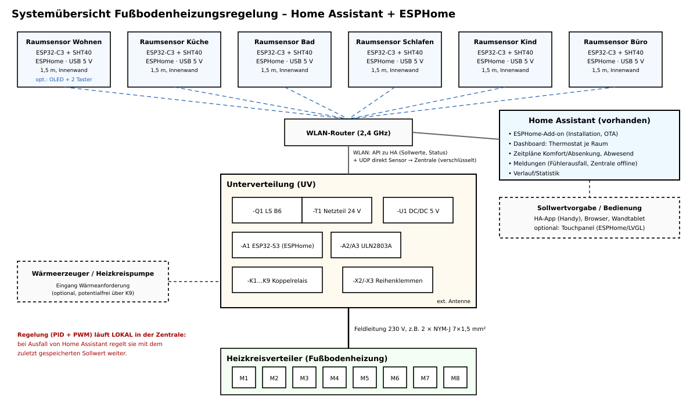
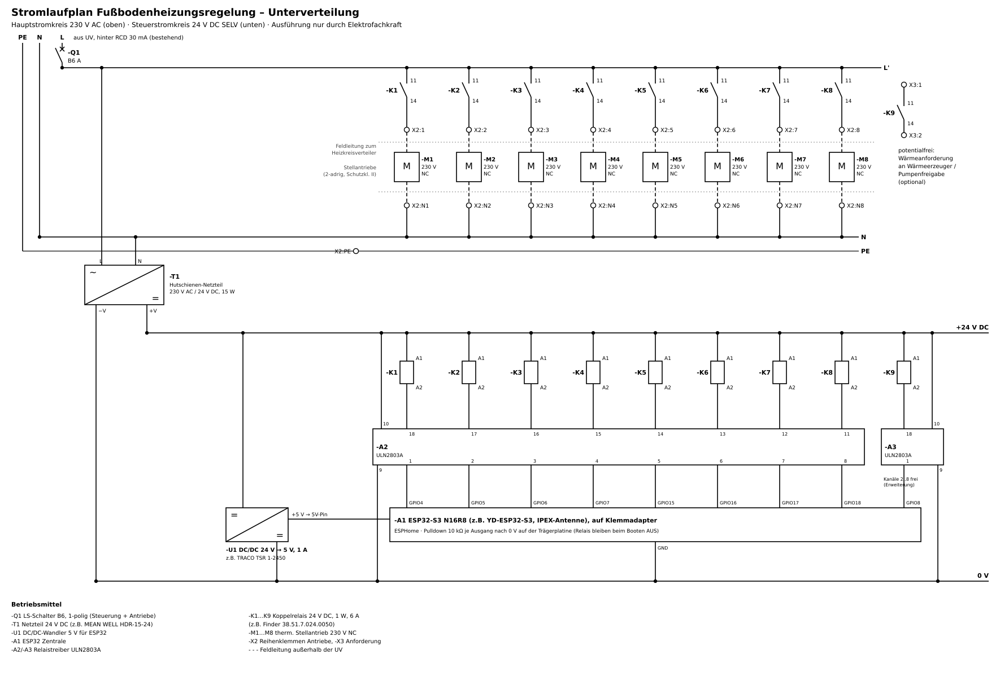
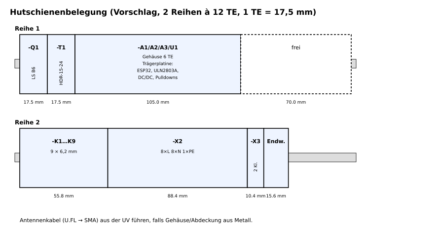
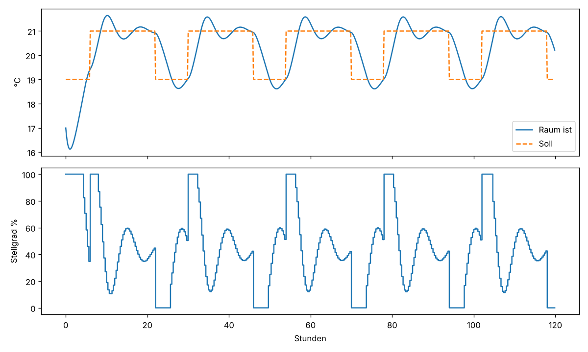

# Fußbodenheizungsregelung mit Home Assistant + ESPHome

Einzelraumregelung für eine wassergeführte Fußbodenheizung, eingebunden in ein **vorhandenes Home Assistant (HA)**:

* **Raumsensoren** (ESP32‑C3 + Sensirion SHT40, ESPHome) messen Temperatur/Feuchte und melden sie an HA und **direkt** an die Zentrale.
* **Zentrale** (ESP32‑S3, ESPHome) in der **Unterverteilung (UV)** regelt jeden Raum **lokal** (PID + langsame PWM) und schaltet über **Koppelrelais** die zugekauften **thermischen 230‑V‑Stellantriebe**.
* **Home Assistant** ist die Bedienoberfläche: Sollwerte, Zeitpläne (Komfort/Absenkung), Abwesenheit, Meldungen und Verlauf.

> ⚠️ **Sicherheit / Recht:** Arbeiten an der elektrischen Anlage hinter der Hausanschlusssicherung dürfen – außer durch den Netzbetreiber – nur von einem **in ein Installateurverzeichnis eingetragenen Elektroinstallationsunternehmen** ausgeführt werden (§ 13 NAV) [Q1]. Der 230‑V‑Teil (UV, Q1, Relaiskontakte, Feldleitung, Stellantriebe) ist daher von einer Elektrofachkraft zu errichten und zu prüfen. Eigenbau: Kleinspannungs‑Elektronik, Raumsensoren, Software.

---

## 1. Kurzantwort: Anzeige, Touchdisplay, Sollwertvorgabe

Die Raumsensoren haben **standardmäßig keine Anzeige**. Die Sollwerte werden in Home Assistant vorgegeben; vor Ort ist eine Anzeige optional:

| Weg | Wie | Ohne HA nutzbar? | Aufwand |
|---|---|---|---|
| **A – HA‑Dashboard** (Standard) | Thermostat‑Karte je Raum in der HA‑App (Handy), im Browser oder auf einem Wandtablet. Fertiges Dashboard: `homeassistant/dashboard_fussbodenheizung.yaml` | nein | keiner |
| **B – Zeitplan** (Standard) | Je Raum Komfort‑ und Absenktemperatur (`input_number`) und Komfortzeiten (`schedule`). Eine Automation setzt den Sollwert an der Zentrale. Schalter „Abwesend“ = alle Räume auf Absenkung | nein | keiner |
| **C – Display + Taster am Raumsensor** (optional) | OLED 0,96″ zeigt Ist, Soll und Ventilstellung; 2 Taster stellen ±0,5 K. Beispiel: Raumsensor Wohnen (`common/raumsensor_display.yaml`) | Anzeige ja, Taster nein* | gering |
| **D – Touch‑Wandpanel** (optional) | z.B. Guition ESP32‑S3‑4848S040 (4″, 480×480) mit ESPHome/LVGL [Q12] oder ein Tablet mit HA‑Dashboard. Eine Bedienstelle für alle Räume | Panel mit ESPHome: nein* | mittel |

\* Die Taster und das Panel ändern den Sollwert über HA (`climate.set_temperature`). Fällt HA aus, **regelt die Zentrale mit dem zuletzt gesetzten Sollwert weiter**; nur die Bedienung ruht.
Für D liefere ich bewusst **keine** fertige Konfiguration: Die Board‑Konfigurationen in der Community ändern sich mit ESPHome‑Versionen, und ich konnte keine davon prüfen. Ausgangspunkt ist die ESPHome‑Geräteseite [Q12].

Eine manuelle Änderung in HA (A/C/D) gilt **bis zum nächsten Schaltpunkt** des Zeitplans. Wer das nicht möchte, schaltet „FBH Zeitprogramm aktiv“ aus.

## 2. Architektur



**Warum regelt die Zentrale selbst und nicht HA?**
Mit HAs „Generic Thermostat“ würde HA direkt die Relais schalten. Dann stünde bei jedem HA‑Neustart, Update oder Ausfall die Heizung still. Hier gilt:

* Die **Regelung** (ESPHome `pid`‑Klima + `slow_pwm`) läuft auf der Zentrale. Sollwerte bleiben im Flash erhalten.
* Die **Raumtemperatur** kommt per `packet_transport` über UDP, verschlüsselt mit gemeinsamem Schlüssel, **direkt** vom Sensor zur Zentrale, nicht über HA [Q13].
* **HA** stellt nur Sollwerte ein und zeigt den Zustand an.

**Fehlerfälle** (Verhalten der Zentrale):

| Ausfall | Folge |
|---|---|
| Home Assistant | Regelung läuft weiter mit letztem Sollwert; kein Zeitplanwechsel, keine Bedienung |
| WLAN‑Router | Kein Messwert mehr → nach 15 min **Ersatzbetrieb 30 %** je Raum; HA meldet nichts, solange HA die Zentrale nicht erreicht |
| Ein Raumsensor | Dieser Raum nach 15 min Ersatzbetrieb 30 %; HA meldet „Fühlerausfall“ |
| Zentrale / Stromausfall | Relais aus → Ventile **zu** (NC‑Antriebe). Nach Neustart Sollwerte aus Flash |
| Raum < 8 °C | **Frostschutz**: Ventil voll auf, auch im Modus „Aus“ |
| Sommer | **Ventilschutz**: montags 11:00 alle Ventile 10 min auf (gegen Festsitzen) |

### Regelprinzip je Raum

1. Der Raumsensor sendet alle 60 s die Temperatur.
2. Der PID‑Regler (ESPHome) berechnet einen Stellgrad 0…100 %. Startwerte: kp = 0,8 je K, ki = 0,8/3 h; Herleitung siehe Kap. 8.
3. Alle 30 s greift eine Sicherheitslogik (`common/zone.yaml`): Pulse unter 10 % entfallen, über 90 % werden zu 100 %, dazu Fühlerausfall, Frostschutz und Ventilschutz.
4. `slow_pwm` mit **20 min Periode** schaltet das Relais. Bei 40 % ist das Ventil 8 min bestromt und 12 min stromlos. Thermische Antriebe brauchen ca. 3 min zum Öffnen [Q2].
5. K9 „Wärmeanforderung“ (potentialfrei) ist geschlossen, solange irgendein Raum heizt.

> Wichtig: Der ESPHome‑PID setzt seinen Ausgang auf 0, sobald der Messwert fehlt (Quellcode `pid_climate.cpp`: bei NaN „turn off all outputs“). Ohne die Zusatzlogik würden bei einem Funkproblem alle Ventile schließen. Deshalb geht der PID‑Wert nicht direkt ans Relais, sondern erst durch die Sicherheitslogik.

## 3. Dateien

| Datei | Inhalt |
|---|---|
| `esphome/fbh-zentrale.yaml` | Zentrale (ESP32‑S3): WLAN, UDP‑Empfang, 6 Zonen, K9, Ventilschutz |
| `esphome/common/zone.yaml` | eine Heizzone (PID, slow_pwm, Sicherheitslogik); wird je Raum mit Variablen eingebunden |
| `esphome/fbh-sensor-<raum>.yaml` | je Raumsensor (6 Stück); Wohnen mit Display + Tastern |
| `esphome/common/raumsensor.yaml` | gemeinsame Basis Raumsensor (SHT40, UDP‑Sender) |
| `esphome/common/raumsensor_display.yaml` | optionale Bedieneinheit (OLED + 2 Taster) |
| `esphome/secrets.yaml.example` | Vorlage für Passwörter/Schlüssel |
| `homeassistant/packages/fussbodenheizung.yaml` | HA‑Paket: Komfort/Absenk‑Werte, Zeitpläne, Automationen, Meldungen |
| `homeassistant/dashboard_fussbodenheizung.yaml` | HA‑Dashboard (Thermostate, Status, Verlauf) |
| `tools/erzeuge_homeassistant.py` | erzeugt die beiden HA‑Dateien aus der Zonenliste (Python) |
| `tools/simulation.py` | PC‑Simulation: ESPHome‑PID + slow_pwm + Raummodell (Python) |
| `tools/zeichne_plaene.py` | erzeugt die SVG‑Pläne (Python) |
| `tests/test_projekt.py` | Konsistenz‑ und Logiktests (Python) |
| `stueckliste.csv` | Stückliste |
| `docs/*.svg` | Systemübersicht, Stromlaufpläne (ESP32‑S3 / ESP32), Hutschiene |

Die frühere MicroPython‑Variante ist entfernt. Sie steht im Git‑Verlauf (Commit `0d648e3`).

## 4. Stückliste

Vollständig in **[`stueckliste.csv`](stueckliste.csv)**. Kurzfassung (Beispiel 6 Räume / 8 Heizkreise):

| Baugruppe | Wesentliche Teile |
|---|---|
| Stellantriebe (Zukauf) | 8 × therm. Stellantrieb 230 V NC (z.B. Möhlenhoff/Theben Alpha 5) + passende Ventiladapter |
| Zentrale (UV) | ESP32‑S3 N16R8 mit IPEX‑Antenne + Klemmadapter, 2 × ULN2803A, DC/DC TSR 1‑2450, 9 × 10 kΩ, Platine, Gehäuse/Leiterplattenhalter |
| Zusatzkomponenten UV | LS B6 (Q1), Netzteil MEAN WELL HDR‑15‑24 (T1), 9 × Koppelrelais Finder 38.51 24 V DC (K1–K9), WAGO‑Reihenklemmen (X2/X3) |
| Feldverdrahtung | Steuerleitung UV → Heizkreisverteiler (z.B. 2 × NYM‑J 7×1,5), Abzweigkasten IP54, Verbindungsklemmen |
| Raumsensoren (je Raum) | ESP32‑C3‑DevKitM‑1, SHT40‑Breakout, Gehäuse, USB‑Netzteil 5 V |
| Optional | OLED SSD1306 + 2 Taster je Raum; Touch‑Wandpanel oder Tablet |

Die Typen sind **Beispiele**; Bestellnummern vor dem Kauf prüfen. Preise sind bewusst nicht angegeben (nicht verifiziert).

## 5. Bauplan (Hardware)

### 5.1 Stromlaufplan Unterverteilung (Zentrale ESP32‑S3)



Schaltzeichen nach DIN EN 60617, Kennbuchstaben nach DIN EN 81346‑2. Oben der 230‑V‑Hauptstromkreis: L' über Q1 → Schließer 11‑14 von K1…K8 → X2 → Stellantrieb → N. Unten der 24‑V‑Steuerstromkreis: T1 → Relaisspule A1; A2 über einen ULN2803A‑Ausgang nach 0 V. Pin 10 (COM) des ULN2803A liegt an +24 V (Freilaufdioden), Pin 9 an 0 V.
Für das klassische ESP32‑DevKitC‑32U gilt `docs/stromlaufplan.svg`; die Pins stehen im Kopf von `fbh-zentrale.yaml`.

### 5.2 Hutschienenbelegung



Platzbedarf ca. 18 TE. Ist die UV voll, einen 2‑reihigen Aufputz‑Kleinverteiler daneben setzen. **Kunststoff‑UV bevorzugen**; bei Metall die Antenne (U.FL→SMA) nach außen führen.

### 5.3 Klemmenplan

| Klemme | Ader / Ziel | Quelle in der UV |
|---|---|---|
| X2:1 … X2:8 | L zu Stellantrieb(en) Zone 1…8 | K1…K8 Kontakt 14 |
| X2:N1 … X2:N8 | N der jeweiligen Zone (blau) | N hinter Q1 |
| X2:PE | Schutzleiter der Feldleitung | PE‑Schiene |
| X3:1 / X3:2 | potentialfreier Kontakt Wärmeanforderung | K9 Kontakt 11 / 14 |
| K1…K9 A1 | +24 V (Brückenkamm) | T1 +V |
| K1…K8 A2 | ULN2803A (A2) Pin 18 … 11 | Trägerplatine |
| K9 A2 | ULN2803A (A3) Pin 18 | Trägerplatine |

Feldleitung (Vorschlag, Auslegung durch die Elektrofachkraft): **2 × NYM‑J 7×1,5 mm²**. Am Heizkreisverteiler in einem Abzweigkasten IP54 auf die Anschlussleitungen der Stellantriebe klemmen. Mehrere Antriebe eines Raums kommen parallel an dieselbe Ader.

### 5.4 Trägerplatine Zentrale (ESP32‑S3, Kleinspannung)

| Funktion | ESP32‑S3‑GPIO | ULN2803A | Relais |
|---|---|---|---|
| Wohnen | GPIO4 | A2 Pin 1 → 18 | K1 |
| Küche | GPIO5 | A2 Pin 2 → 17 | K2 |
| Bad | GPIO6 | A2 Pin 3 → 16 | K3 |
| Schlafen | GPIO7 | A2 Pin 4 → 15 | K4 |
| Kind | GPIO15 | A2 Pin 5 → 14 | K5 |
| Büro | GPIO16 | A2 Pin 6 → 13 | K6 |
| Reserve | GPIO17 / GPIO18 | A2 Pin 7/8 → 12/11 | K7 / K8 |
| Wärmeanforderung | GPIO8 | A3 Pin 1 → 18 | K9 |
| Status‑LED | GPIO9 (330 Ω + LED nach GND) | – | – |

* Jeder Relais‑GPIO bekommt einen **10‑kΩ‑Pulldown** nach GND, damit beim Booten kein Relais anzieht.
* **Gemiedene GPIOs:**
  * Strapping‑Pins 0, 3, 45, 46 [Q8]
  * USB 19/20
  * Flash 26…32
  * Octal‑PSRAM 33…37 beim N16R8 [Q8][Q9]
  * UART0 43/44
  * GPIO48 (WS2812‑LED des YD‑Boards) [Q9]
* **Versorgung:** 5 V vom DC/DC (U1) an den 5V‑Pin des Boards. Beim Programmieren über USB die 24 V abschalten, solange nicht geklärt ist, ob das Board eine Rückspeisediode hat.
* **Antenne:** Bei IPEX‑Varianten wird oft per 0‑Ω‑Brücke zwischen PCB‑ und IPEX‑Antenne umgeschaltet [Q11]. Für dieses Board ist das nicht verifiziert: nachsehen bzw. Händler fragen.
* **24‑V‑Leitungen:** in der UV mit 300/500‑V‑Isolierung (H05V‑K) und **getrennt** von 230 V führen (SELV, DIN VDE 0100‑410; Bewertung durch die Elektrofachkraft).

### 5.5 Raumsensor (je Raum)

| SHT40‑Breakout | OLED (optional) | Taster (optional) | ESP32‑C3‑DevKitM‑1 |
|---|---|---|---|
| VIN | VCC | – | 3V3 |
| GND | GND | je ein Pol | GND |
| SDA | SDA | – | GPIO4 |
| SCL | SCL | – | GPIO5 |
| – | – | „+“ | GPIO6 |
| – | – | „−“ | GPIO7 |

* GPIO2, GPIO8 und GPIO9 sind beim ESP32‑C3 Strapping‑Pins, GPIO18/19 sind USB. Deshalb 4–7.
* **Montage:** ca. 1,5 m Höhe an einer Innenwand, nicht über Heizflächen, nicht in direkter Sonne.
* **Eigenerwärmung:** Das WLAN ist dauerhaft aktiv. Den SHT40 darum mit 5–10 cm Kabel **räumlich vom ESP32 trennen** (Trennsteg, Lüftungsschlitze unten/oben). Die Sendeleistung ist auf 11 dB reduziert. Danach mit Referenzthermometer abgleichen (`offset`).
* **Genauigkeit SHT40:** typ. ±0,2 °C, max. ±0,4 °C (0…65 °C) [Q3]. Die Sensor‑Heizung des SHT40 bleibt aus (ESPHome‑Standard `heater_max_duty: 0`).

## 6. Einrichtung in Home Assistant

1. **ESPHome‑Add‑on** (bzw. ESPHome Device Builder) in HA installieren.
2. Den Ordner `esphome/` (inkl. `common/`) nach `/config/esphome/` kopieren. `secrets.yaml.example` → `secrets.yaml` und ausfüllen. API‑Schlüssel erzeugen mit
   `python3 -c "import base64,os;print(base64.b64encode(os.urandom(32)).decode())"`.
3. **Erstes Flashen per USB** (Add‑on → Gerät → Installieren → „Plug into this computer“ bzw. ESPHome Web). Danach gehen Updates per WLAN (OTA).
   ESP32‑S3‑Board: den USB‑Port mit dem USB‑Seriell‑Chip (CH343) verwenden.
4. Die Geräte erscheinen unter *Einstellungen → Geräte & Dienste → ESPHome* → hinzufügen (API‑Schlüssel).
5. Nur für Raumsensoren mit Tastern: in der Gerätekonfiguration der ESPHome‑Integration „**Dem Gerät erlauben, Home‑Assistant‑Aktionen auszuführen**“ einschalten.
6. **Paket** einbinden: in `configuration.yaml`
   ```yaml
   homeassistant:
     packages: !include_dir_named packages
   ```
   Dann `homeassistant/packages/fussbodenheizung.yaml` nach `/config/packages/` kopieren und HA neu starten.
7. **Dashboard:** *Einstellungen → Dashboards → Dashboard hinzufügen*, dann ⋮ → *Raw‑Konfigurationseditor* → Inhalt von `dashboard_fussbodenheizung.yaml` einfügen.
8. **Entity‑IDs prüfen.** Die Dateien erwarten z.B.
   * `climate.fbh_zentrale_wohnen`
   * `sensor.fbh_zentrale_stellgrad_wohnen`
   * `sensor.fbh_zentrale_status_wohnen`
   * `sensor.raumsensor_wohnen_luftfeuchte`
   * `binary_sensor.fbh_zentrale_warmeanforderung`

   HA bildet sie aus Geräte‑ und Entitätsnamen; Umlaute verlieren dabei die Punkte („Küche“ → `climate.fbh_zentrale_kuche`, „Büro“ → `…_buro`). Der Generator rechnet das genauso um. Weichen die IDs trotzdem ab (z.B. weil HA schon eine gleichnamige Entität kannte und `_2` anhängt), in HA umbenennen oder `tools/erzeuge_homeassistant.py` anpassen und neu erzeugen.

**Räume ändern:** An drei Stellen anpassen und danach `python3 -m unittest discover -s tests` laufen lassen; der Test prüft, dass alles zusammenpasst.
1. `fbh-zentrale.yaml`: `packages` und `providers`
2. je Raum eine `fbh-sensor-<raum>.yaml`
3. `ZONEN` in `tools/erzeuge_homeassistant.py`, danach `python3 tools/erzeuge_homeassistant.py`

## 7. Inbetriebnahme (Reihenfolge)

1. **Hydraulischen Abgleich** des Heizkreisverteilers prüfen bzw. durchführen lassen.
2. Die Elektrofachkraft errichtet den UV‑Teil und die Feldleitung und macht die **Erstprüfung** (Isolationswiderstand, Schutzleiter, RCD) mit Dokumentation.
3. Zentrale zunächst ohne 230 V an Q1 (nur T1) einschalten. In HA einen Raum auf 28 °C stellen → nach ≤ 30 s muss die LED des Relais leuchten. Alle Kanäle durchgehen.
4. Q1 einschalten und je Kanal prüfen, ob der **richtige** Stellantrieb öffnet (nach ca. 3 min am Stellungsanzeiger). Neue Antriebe haben eine „First‑Open“‑Stellung: Sie sind bei Lieferung offen und rasten erst nach dem ersten längeren Bestromen aus (laut Anleitung des Antriebs).
5. Raumsensoren einschalten. „Status <Raum>“ muss von „Fühlerausfall…“ auf „Regelung“ wechseln.
6. Sensor‑`offset` mit einem Referenzthermometer abgleichen.
7. 1–2 Wochen beobachten (Verlauf in HA), ggf. `kp`/`ki` in `common/zone.yaml` anpassen.

## 8. Regelverhalten (Simulation) und Prüfungen

```bash
python3 tools/simulation.py --plot          # Standard kp=0,8, Tn=3 h
python3 tools/simulation.py --kp 0.5 --tn 7200
```



Die Simulation bildet den PID‑Regler aus ESPHome (`pid_controller.cpp`), `slow_pwm` und die Sicherheitslogik nach. Das Raummodell ist ein **vereinfachtes RC‑Modell mit angenommenen Werten** (20 m², 6,5 cm Estrich), **keine Messung**. Am Tag 3 fällt der Sensor 6 h aus (orange); der Ersatzbetrieb mit 30 % hält den Raum im Modell warm.

Ergebnisse im Modell (mittlere bzw. maximale Abweichung 08–21 Uhr, 2 K Nachtabsenkung):

| kp | Tn | mittlere Abweichung | max. Abweichung |
|---|---|---|---|
| 0,5 | 2 h | 0,40 K | 1,04 K |
| **0,8** | **3 h** | **0,24 K** | **0,93 K** |
| 1,0 | 4 h | 0,22 K | 0,98 K |

Die Spitzen kommen vom Aufheizen nach der Nachtabsenkung, die beim trägen Estrich überschwingt. Absenkungen über 2 K bringen bei Fußbodenheizung meist wenig.

**Was geprüft wurde (in dieser Umgebung, ESPHome 2026.11.0):**

| Prüfung | Ergebnis |
|---|---|
| `esphome config` für alle 7 YAML‑Dateien | gültig, ohne Warnungen |
| Kompilierung für ESP32‑S3 | **nicht möglich**: Die Umgebung darf dl.espressif.com (ESP‑IDF) nicht laden |
| Kompilierung der Zonenlogik auf ESPHome‑„host“ (Linux) | erfolgreich; alle C++‑Lambdas übersetzen |
| Ende‑zu‑Ende‑Test auf „host“: simulierter Raumsensor → verschlüsseltes UDP → Zentrale | ohne Sensor 30 % „Fühlerausfall“; mit 19 °C bei Soll 21 °C → 100 % „Regelung“; Sensor weg → zurück in den Ersatzbetrieb (Timeout für den Test auf 20 s verkürzt) |
| `tests/test_projekt.py` (13 Tests) | OK |
| Home‑Assistant‑Paket | siehe Hinweis in Kap. 11 |

Die erste Kompilierung für das echte Board erfolgt also bei Ihnen im ESPHome‑Add‑on.

## 9. Leistungs‑ und Strombilanz

| Verbraucher | Wert | Herkunft |
|---|---|---|
| Stellantrieb Alpha 5 230 V | ca. 1 W, Einschaltstrom max. 550 mA für 100 ms, Laufzeit ca. 3 min | Theben‑Datenblatt 9070441 (über Händler/Suche) [Q2] |
| 8 Antriebe gleichzeitig (Worst Case) | ≈ 8 W Dauer, ≈ 4,4 A für 100 ms | Rechnung |
| 9 Relaisspulen Finder 38.51 | je 10,4 mA → ≈ 94 mA bei 24 V | Händlerangaben [Q5] |
| ESP32‑S3 über DC/DC | Annahme ≤ 0,5 A bei 5 V → ≈ 0,12 A bei 24 V | Annahme, nicht gemessen |
| **Summe 24 V** | **≈ 0,21 A** < 0,63 A Nennstrom HDR‑15‑24 | [Q6] |

## 10. Grenzen und offene Punkte

* Die Raumsensoren brauchen **WLAN und USB‑Netzteil**. Batteriebetrieb ist in diesem Konzept nicht vorgesehen, weil das WLAN dauerhaft aktiv ist.
* Ohne WLAN fehlen der Zentrale die Messwerte (→ Ersatzbetrieb 30 %). ESPHome kann `packet_transport` auch über **ESP‑NOW** statt UDP übertragen [Q14]. Das hängt aber am WLAN‑Kanal des Routers und ist hier nicht umgesetzt.
* Keine Kühlfunktion (keine Taupunktüberwachung).
* Mit `kd` = 0 arbeitet der Regler als PI‑Regler. ESPHome bietet `climate.pid.autotune`; bei Fußbodenheizung dauert das wegen der Trägheit sehr lange.

## 11. Hinweis zur Prüfung des HA‑Pakets

Ich habe die Automationen in der aktuellen Syntax (`triggers:`/`actions:`, `action: climate.set_temperature`) geschrieben. Wenn möglich, zusätzlich mit *Entwicklerwerkzeuge → YAML → Konfiguration prüfen* in Ihrem HA kontrollieren.

## 12. Quellen

* [Q1] § 13 NAV: [gesetze-im-internet.de/nav/__13.html](https://www.gesetze-im-internet.de/nav/__13.html); BDEW/ZVEH‑Grundsätze: [bdew.de (PDF)](https://www.bdew.de/documents/5713/20200507__Grundsaetze_BDEW_ZVEH.pdf)
* [Q2] Theben ALPHA 5 230 V (9070441): [theben.de](https://www.theben.de/produkt/9070441/datenblatt), [siblik.com (PDF)](https://siblik.com/fileadmin/mam/medias/docus/136/Artikel_T9070441_Datenblatt.pdf); Möhlenhoff Alpha 5: [voltus.com](https://www.voltus.com/en/moehlenhoff-a20405-00-883-01-heating-actuator-alpha-5-230-v-nc-incl-va80-white.html). *Werte aus Suchzusammenfassung; Originaldatenblätter hier nicht abrufbar – vor Bestellung prüfen.*
* [Q3] Sensirion SHT40: [sensirion.com](https://sensirion.com/products/catalog/SHT40); SHT4x‑Vergleich: [farnell.com (PDF)](https://www.farnell.com/datasheets/3704058.pdf)
* [Q5] Finder 38.51.7.024.0050: [buerklin.com](https://buerklin.com/en/p/finder/coupling-relays/38-51-7-024-0050/34G1383), [rs-online.com](https://uk.rs-online.com/web/p/interface-relay-modules/3864419), [findernet.com (PDF)](https://cdn.findernet.com/app/uploads/S38DE.pdf)
* [Q6] MEAN WELL HDR‑15‑24: [digikey](https://www.digikey.co.uk/en/products/detail/mean-well-usa-inc/HDR-15-24/7703794), [bravoelectro.com](https://www.bravoelectro.com/hdr-15-24.html)
* [Q8] Espressif ESP32‑S3 Hardware Design Guidelines: [espressif.com (PDF)](https://www.espressif.com/sites/default/files/documentation/esp32-s3_hardware_design_guidelines_en.pdf); RIOT‑OS: [doc.riot-os.org](https://doc.riot-os.org/group__cpu__esp32__esp32s3.html)
* [Q9] YD‑ESP32‑S3: [github.com/vcc-gnd/YD-ESP32-S3](https://github.com/vcc-gnd/YD-ESP32-S3), Schaltplan: [mischianti.org (PDF)](https://mischianti.org/wp-content/uploads/2023/08/YD-ESP32-S3-SCH-V1.4.pdf)
* [Q11] Antennenumschaltung per 0‑Ω (allgemein): [esp32.com](https://esp32.com/viewtopic.php?p=45323)
* [Q12] Guition ESP32‑S3‑4848S040 in ESPHome: [devices.esphome.io](https://devices.esphome.io/devices/guition-esp32-s3-4848s040), Community‑Thread: [community.home-assistant.io](https://community.home-assistant.io/t/guition-4-480x480-esp32-s3-4848s040-smart-display-with-lvgl/729271)
* [Q13] ESPHome Packet Transport / UDP: [esphome.io/components/packet_transport](https://esphome.io/components/packet_transport/), [esphome.io/components/udp](https://esphome.io/components/udp/)
* [Q14] ESPHome ESP‑NOW: [esphome.io/components/espnow](https://esphome.io/components/espnow/), [ESP‑NOW Packet Transport](https://esphome.io/components/packet_transport/espnow/)
* ESPHome PID‑Klima: [esphome.io/components/climate/pid](https://esphome.io/components/climate/pid/); Praxiswerte Fußbodenheizung: [community.home-assistant.io](https://community.home-assistant.io/t/esphome-starting-parameters-pid-controller-underfloor-heating/525267)
* Verhalten von PID (NaN → Ausgang 0), `slow_pwm`, `packet_transport`, `timeout`‑Filter: direkt aus dem Quellcode des PyPI‑Pakets `esphome` 2026.11.0 geprüft (`components/pid/pid_climate.cpp`, `pid_controller.cpp`, `slow_pwm/slow_pwm_output.cpp`, `sensor/__init__.py`).
